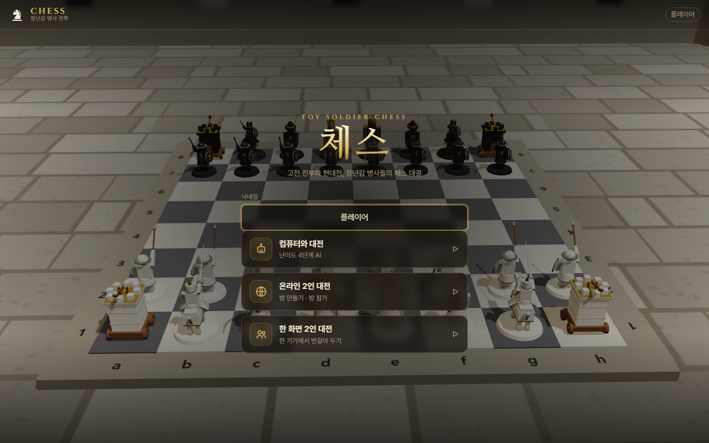
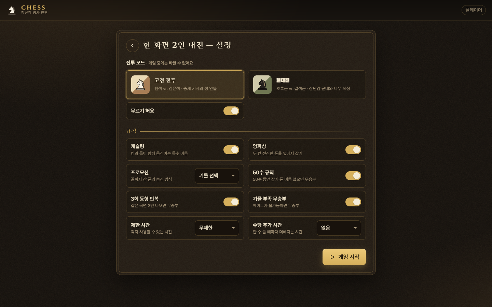
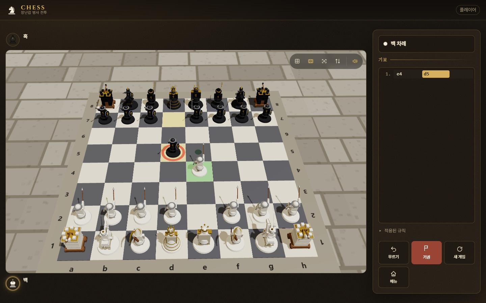
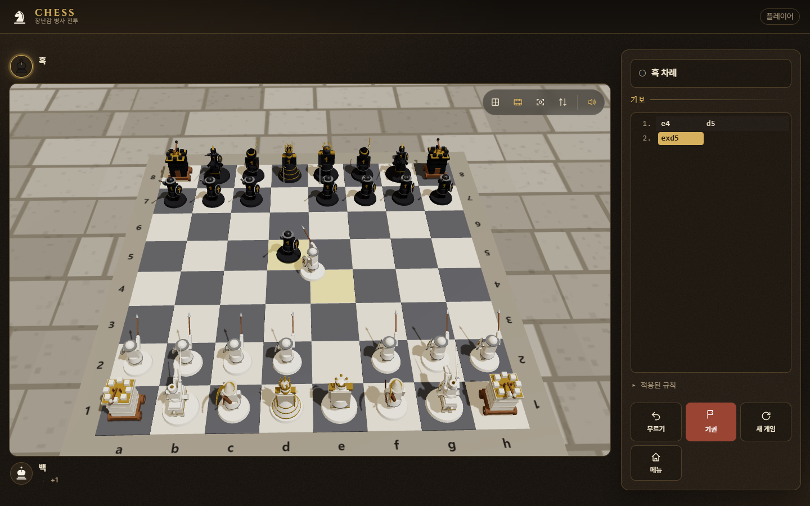
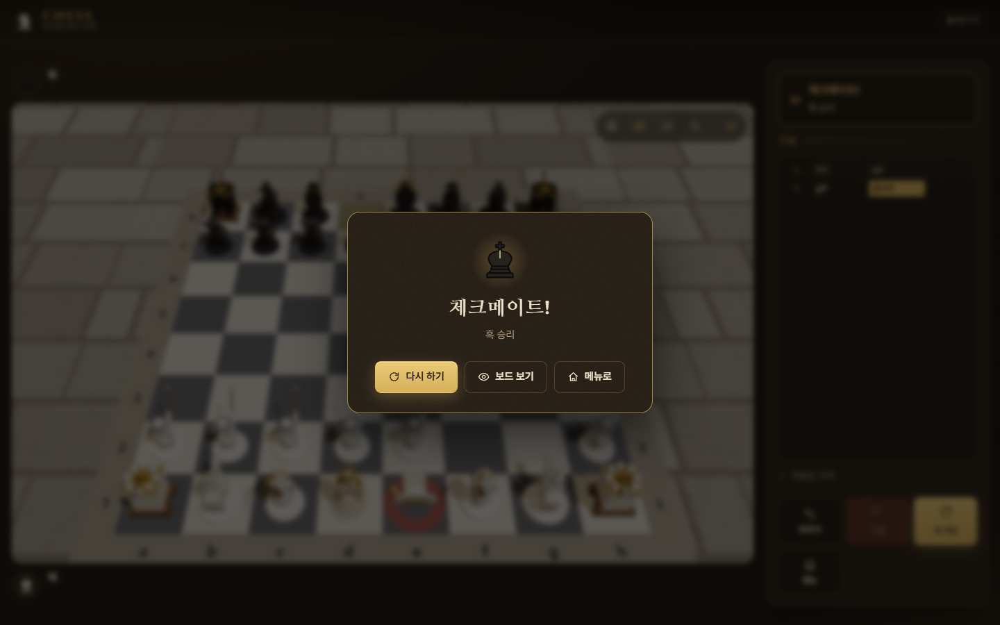
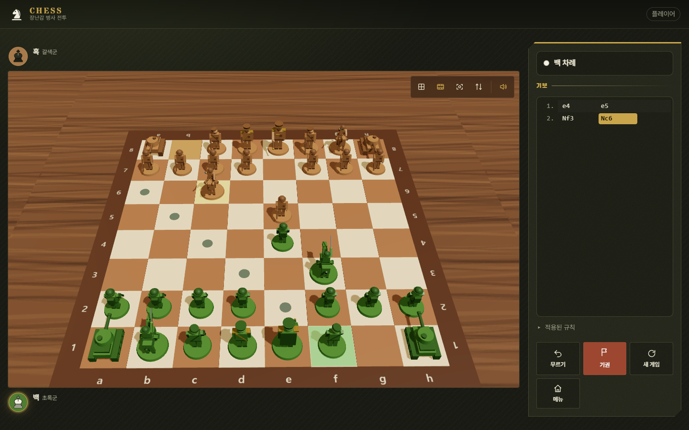

# ♞ 체스 — 장난감 병사 전투 (game-chess-maker)

> 장난감 병사들이 실제로 싸우는 3D 체스. 컴퓨터 대전, 온라인 방 대전, 한 화면 2인 대전을 지원하는 브라우저 게임입니다.

**[▶ 플레이하기](https://kim-sangbum.github.io/game-chess-maker/)** · **[📄 소개 페이지](https://kim-sangbum.github.io/game-chess-maker/docs/)**



## 개요

정식 체스 규칙을 따르는 브라우저 체스 게임입니다. 기물은 3D 장난감 병사로 표현되고, 기물을 잡으면 병사가 실제로 공격하는 연출이 나옵니다.
전투 모드는 두 가지입니다.
- **고전 전투**: 흰색 vs 검은색, 중세 기사
- **현대전**: 초록군 vs 갈색군, 현대 장난감 군대

게임을 시작할 때 규칙(캐슬링, 앙파상, 무승부 규칙, 제한 시간 등)을 고를 수 있습니다.

## 주요 기능

- **세 가지 대전 방식**
  - 컴퓨터와 대전: AI 난이도 4단계 (쉬움 / 보통 / 어려움 / 매우 어려움)
  - 온라인 2인 대전: 방을 만들고, 다른 사람이 참가하고, 방장이 시작
  - 한 화면 2인 대전: 한 기기에서 번갈아 두기
- **정식 체스 규칙**: 캐슬링, 앙파상, 프로모션, 체크메이트·스테일메이트, 50수 규칙, 3회 동형 반복, 기물 부족 무승부
- **시작할 때 규칙 선택**: 각 규칙 켜기/끄기, 프로모션 방식(기물 선택 / 자동 퀸), 제한 시간, 수당 추가 시간
- **3D 장난감 병사와 공격 연출**: 기물마다 다른 공격, 잡힌 기물이 쓰러져 튕겨 나가는 장면, 게임이 끝날 때의 연출
- **두 가지 전투 모드**: 모드에 따라 병사, 배경, 효과음, 화면 분위기(고전 = 양피지·금색, 현대전 = 군용 카키)가 바뀝니다
- **2D 보드 전환**: 직접 그린 SVG 기물의 2D 보드로 언제든 바꿀 수 있습니다
- **효과음**: Web Audio로 합성한 소리. 외부 소리 파일은 없습니다
- **휴대폰 화면 대응**: 세로 화면에서는 보드가 위, 정보가 아래, 주요 버튼은 하단 바에 놓입니다

### ⚔ 고전 전투 (기본) — 흰색 vs 검은색, 성 안뜰의 돌 체스판

| 체스 기물 | 병사 | 공격 방식 |
|---|---|---|
| 폰 | 창병 | 창 찌르기 |
| 나이트 | 기마 기사 | 랜스 돌격 |
| 비숍 | 궁수 | 활 쏘기 |
| 룩 | 이동식 성탑 | 탑 위 투석기 발사 |
| 퀸 | 여왕 기사 | 검 베기 |
| 킹 | 왕 | 검 내려치기 |

체크메이트, 기권, 시간 초과, 상대 탈주로 지면 진 쪽 왕의 왕관이 떨어지고, 왕이 무릎 꿇은 뒤 쓰러집니다.

### 🪖 현대전 — 백 = 초록군, 흑 = 갈색군, 나무 책상

| 체스 기물 | 병사 | 공격 방식 |
|---|---|---|
| 폰 | 소총병 | 소총 사격 |
| 나이트 | 기병 | 말 타고 돌격, 칼 베기 |
| 비숍 | 저격수 | 조준 후 저격 |
| 룩 | 탱크 | 포격 + 폭발 |
| 퀸 | 장교 | 권총 2연발 |
| 킹 | 장군 | 지휘봉 공격 |

같은 상황에서 진 쪽 장군은 백기를 들고 쓰러집니다.

## 게임 방법

일반 체스와 같습니다. 상대 킹을 체크메이트하면 이깁니다.
- **무승부**: 스테일메이트, 그리고 켜 둔 규칙(50수, 3회 반복, 기물 부족), 온라인 대전의 무승부 합의
- **패배**: 기권, 제한 시간 소진(상대에게 메이트할 기물이 없으면 무승부), 온라인 대전 중 나가기

**전투 모드 선택**
- 게임 설정 화면에서 고릅니다. 설정 화면을 열 때마다 고전 전투가 선택되어 있고, 게임 중에는 바꿀 수 없습니다.
- 온라인 대전에서는 각자 자기 화면의 모드를 고릅니다. 방장은 방을 만들 때, 참가자는 방 대기실에서 고릅니다.

**온라인 대전 흐름**
1. 홈 → **온라인 2인 대전** → 로비
2. **방 만들기** → 전투 모드, 방 이름, 방장 기물 색, 규칙 선택
3. 상대는 로비 목록에서 **참가**를 누르거나 **4자리 방 코드**를 입력
4. 상대가 들어오면 방장이 **게임 시작**
5. 대국 중에는 무승부 제안과 기권을 할 수 있습니다. 게임이 끝나면 방장이 **재대결**을 시작할 수 있습니다

모든 수와 시간은 서버에서 검증합니다. 대국 중에 나가거나 연결이 끊기면 그 사람의 패배로 처리됩니다.

### 조작

| 입력 | 동작 |
|---|---|
| 기물 클릭 → 이동할 칸 클릭 | 기물 선택과 이동 (3D·2D 공통). 이동 가능한 칸은 점, 잡을 수 있는 칸은 고리로 표시 |
| 기물 드래그 | 2D 보드에서 끌어서 이동 |
| 마우스 드래그 (3D) | 시점 회전 |
| 마우스 휠 (3D) | 확대 / 축소 |
| `Esc` | 선택 해제, 결과 팝업 닫기 |
| 보드 오른쪽 위 아이콘 | 2D/3D 전환, 연출 속도(보통 / 빠르게 / 끄기), 시점 초기화, 보드 뒤집기, 소리 켜기/끄기 |
| 오른쪽 패널 버튼 | 무르기(허용한 경우), 기권, 새 게임, 메뉴 / 온라인: 무승부 제안, 기권, 재대결, 대기실, 나가기 |

## 스크린샷

실행 중인 게임을 headless Chrome으로 직접 조작해서 찍은 실제 화면입니다 (1440×900).

| | |
|---|---|
|  |  |
| **홈 화면**: 뒤에서 고전 전투 3D 체스판이 회전 | **게임 설정**: 전투 모드 카드와 규칙 선택 |
|  |  |
| **고전 전투**: e4 폰을 선택해 잡을 수 있는 칸(d5)이 표시된 상태 | **공격 연출**: 흰 창병이 d5의 검은 창병에게 다가가 창으로 찌르기 직전 |
|  |  |
| **결과 화면**: 체크메이트(흑 승리) 팝업 | **현대전**: 초록군 vs 갈색군, 비숍(저격수)의 이동 가능한 칸 표시 |

## 기술 스택

- **실행 환경 / 플랫폼**: 웹 브라우저 + Node.js 서버
- **프레임워크 / 엔진**: 프레임워크 없이 직접 작성 (규칙 엔진, AI, UI)
- **언어**: JavaScript (HTML, CSS)
- **주요 라이브러리**
  - [three](https://threejs.org/) 0.170: 3D 렌더링
  - [ws](https://github.com/websockets/ws) 8: 온라인 대전 WebSocket 서버
  - 글꼴: Pretendard, Cinzel, 나눔명조, 검은고딕, Stardos Stencil (npm 설치, 오프라인 동작, SIL OFL)
- **AI**: 알파-베타 탐색 + 정지 탐색 + 반복 심화 (Web Worker에서 실행)

## 시작하기

### 준비물

- Node.js (v26.13에서 확인)
- 최신 브라우저 (3D에는 WebGL 필요. 안 되면 자동으로 2D 보드를 씁니다)

### 설치

```bash
npm install
```

### 실행

```bash
npm start
```

브라우저에서 **http://localhost:3100** 에 접속합니다. 소개 페이지는 http://localhost:3100/docs/ 입니다.
같은 와이파이·네트워크의 친구는 서버 시작 시 터미널에 표시되는 `http://<이 컴퓨터의 내부 IP>:3100` 주소로 접속하면 됩니다. 접속이 안 되면 Windows 방화벽에서 Node.js를 허용해 주세요.

포트를 바꾸려면 `PORT=8080 npm start`를 씁니다 (PowerShell: `$env:PORT=8080; npm start`).

## 배포

게임 화면은 **GitHub Pages**에, 온라인 대전 서버는 **Render**에 올리는 구성입니다.
- AI 대전과 한 화면 대전은 Pages만으로 동작합니다.
- 온라인 대전만 Render 서버에 WebSocket으로 연결합니다.

| 구성 | 역할 | 주소 | 설정 파일 |
|---|---|---|---|
| GitHub Pages | 게임 정적 버전 | https://kim-sangbum.github.io/game-chess-maker/ | `.github/workflows/pages.yml`, `scripts/build-pages.mjs` |
| GitHub Pages | 소개 페이지 | https://kim-sangbum.github.io/game-chess-maker/docs/ | (위와 같음) |
| Render (무료) | 온라인 대전 서버 (`server.js`) | 아직 연결 안 됨 | `render.yaml` |

현재 배포된 사이트에는 온라인 대전 서버가 연결되어 있지 않습니다. 그래서 온라인 2인 대전 메뉴를 누르면 안내 메시지가 나옵니다. 온라인 대전까지 하려면 내 컴퓨터에서 실행하거나 아래 2~3단계를 진행하세요.

**처음 한 번 설정**

1. **GitHub Pages**: 저장소 Settings → Pages → Source를 **GitHub Actions**로 바꿉니다. 그 뒤로 `main`에 push할 때마다 자동으로 배포됩니다.
2. **Render**: [render.com](https://render.com)에 GitHub으로 로그인합니다. New → **Blueprint** → 이 저장소를 고르면 `render.yaml` 설정으로 서버가 만들어집니다.
3. **두 서비스 연결**: Render가 준 주소(예: `https://game-chess-maker.onrender.com`)를 GitHub 저장소 Settings → Secrets and variables → Actions → **Variables**에 `ONLINE_SERVER_URL`로 등록합니다. 그다음 Actions에서 Pages 배포를 다시 실행합니다.

**참고**
- Render 무료 서버는 15분 동안 접속이 없으면 잠듭니다. 잠든 상태에서 온라인 대전에 들어가면 게임이 서버를 먼저 깨우고(최대 1분) 연결합니다. 잠들면 진행 중이던 방은 사라집니다.
- `ONLINE_SERVER_URL`을 등록하기 전에는 Pages 사이트의 온라인 대전 메뉴에서 "서버가 연결되어 있지 않다"는 안내가 나옵니다.
- Pages 빌드를 로컬에서 확인하려면 `ONLINE_SERVER_URL=http://localhost:3100 npm run build:pages`를 실행합니다. 결과는 `_site/`에 생깁니다.

## 프로젝트 구조

```text
game-chess-maker/
├── server.js              # 정적 파일 서버 + WebSocket 방/대국 서버 (모든 수 검증, /health)
├── package.json
├── render.yaml            # Render 배포 설정 (온라인 대전 서버)
├── scripts/build-pages.mjs      # GitHub Pages용 정적 사이트 빌드 → _site/
├── .github/workflows/pages.yml  # push 시 Pages 자동 배포
├── public/
│   ├── config.js          # 온라인 서버 주소 설정 (Pages 빌드 시 자동 생성)
│   ├── index.html         # 화면 구성
│   ├── style.css          # 스타일 (고전 / 현대전 분위기)
│   ├── app.js             # 화면 전환, 보드 입력, 게임 진행, 온라인 연결
│   ├── chess.js           # 규칙 엔진 (브라우저와 서버가 함께 사용)
│   ├── ai.js              # 체스 AI (Web Worker)
│   ├── board3d.js         # 3D 보드, 장난감 병사 모델, 공격 연출 (Three.js)
│   ├── sound.js           # 효과음 (Web Audio 합성)
│   └── art.js             # 2D 기물 SVG, UI 아이콘
└── docs/
    ├── index.html         # 게임 소개 페이지
    ├── screenshots/       # 실제 게임 화면 캡처
    ├── tools/capture-flow.mjs   # 스크린샷 캡처 흐름 (headless Chrome + CDP)
    └── game-documentation-report.md
```

## 알려진 제한 사항

- 3D 연출 시간도 시계에 포함됩니다. 연출 중에도 다음 수는 바로 둘 수 있습니다.
- 3D 보드에서는 드래그가 시점 회전이라, 기물은 클릭으로 옮깁니다 (2D 보드는 드래그 이동 가능).
- 홈 화면 3D 배경은 PC 화면에서만 나옵니다. 휴대폰, 좁은 화면, 모션 줄이기 설정, 3D 불가 기기에서는 정지 배경입니다.
- 온라인 방과 대국 정보는 서버 메모리에만 있어서, 서버를 다시 시작하면 사라집니다.
- AI(Web Worker), 3D, 글꼴은 서버를 통해 열어야 동작합니다 (`index.html`을 파일로 직접 열면 안 됩니다).

## 로드맵

현재 계획된 항목은 없습니다.

---

*프로젝트 소스와 실제 실행 화면을 바탕으로 작성한 문서입니다. 마지막 갱신: 2026-11-16.*
